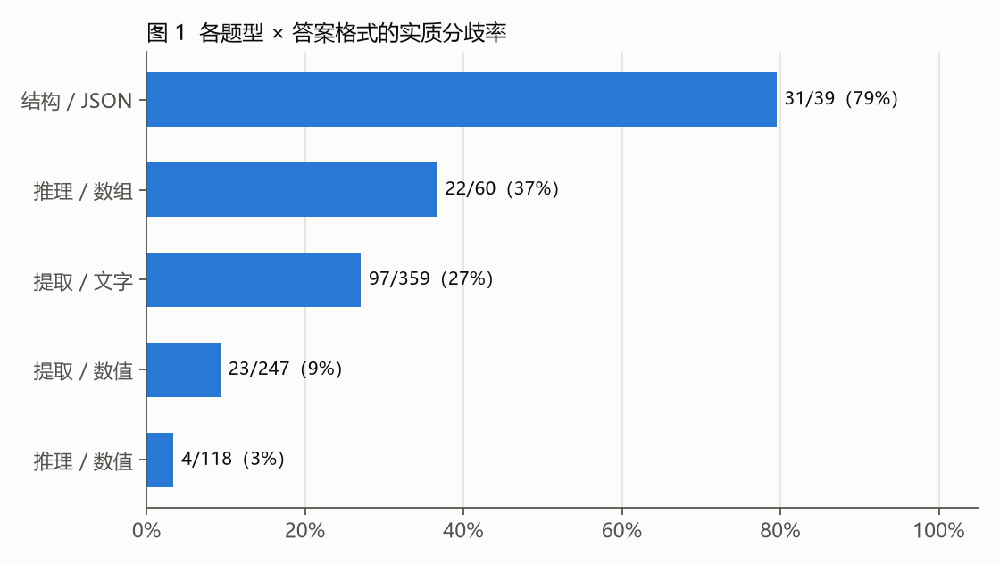

# 多模态表格问答：错误归因与干预实验

天池「知乎表格问答」长期赛 S2 的个人复盘：在只能用千问系列模型的条件下，对 908 道表格问答题做错误归因，并用单变量对照检验 7 组干预手段。

- 完整报告：[report/表格问答错误归因报告.md](report/表格问答错误归因报告.md)
- 配图：`figures/`，由 `scripts/make_figures.py` 生成



## 主要结论

1. 错误分散：90 份文档中 79 份有分歧，没有可集中攻克的模板族。
2. 结构题错误率最高（31 / 39 有分歧），专项规则在合成验证集上修好 16、改坏 0。
3. 退化图误读、密排表定位偏行在放大、分块、方向校正后仍未解决。
4. 同配置自一致投票在覆盖题型上无收益（净 −1）。

## 目录

- `report/`：报告正文
- `figures/`：三张配图
- `scripts/diag.py`：分级比较口径（表示差异 / 软差异 / 实质差异）
- `scripts/cluster.py`：按文档、题型、文件类型聚合分歧
- `scripts/make_figures.py`：配图脚本，只用报告中的汇总数字

## 运行

```bash
pip install matplotlib
python scripts/make_figures.py
```

`diag.py`、`cluster.py` 需要比赛官方数据，数据与提交答案按比赛规则不随仓库公开；有数据时用环境变量 `TABLEQA_ROOT`（工作目录）和 `TABLEQA_TESTS`（官方题目表）指定路径。

## 口径声明

只使用一次性全量生成的干净底子和离线实验；按平台分数挑选答案得到的版本不纳入结论。