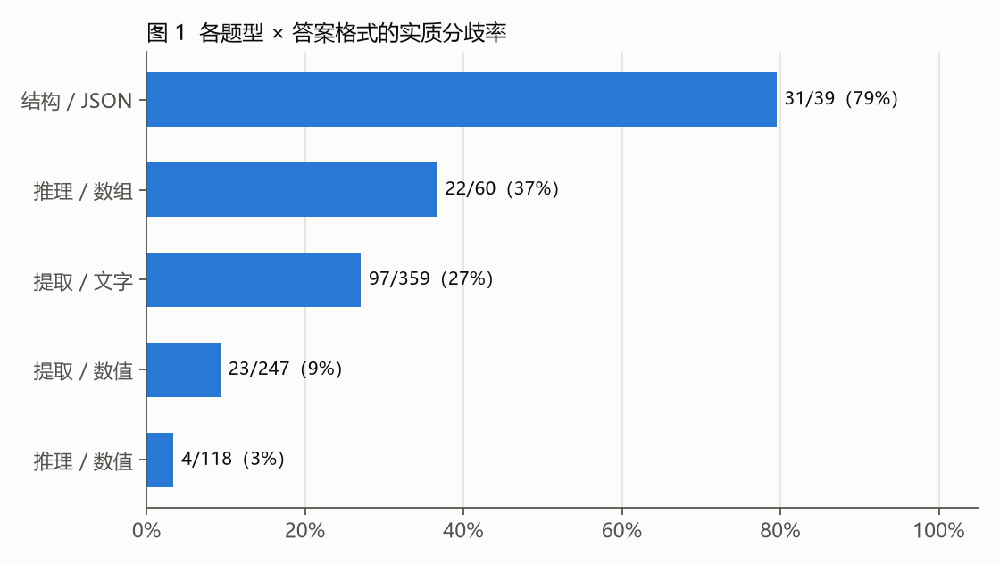
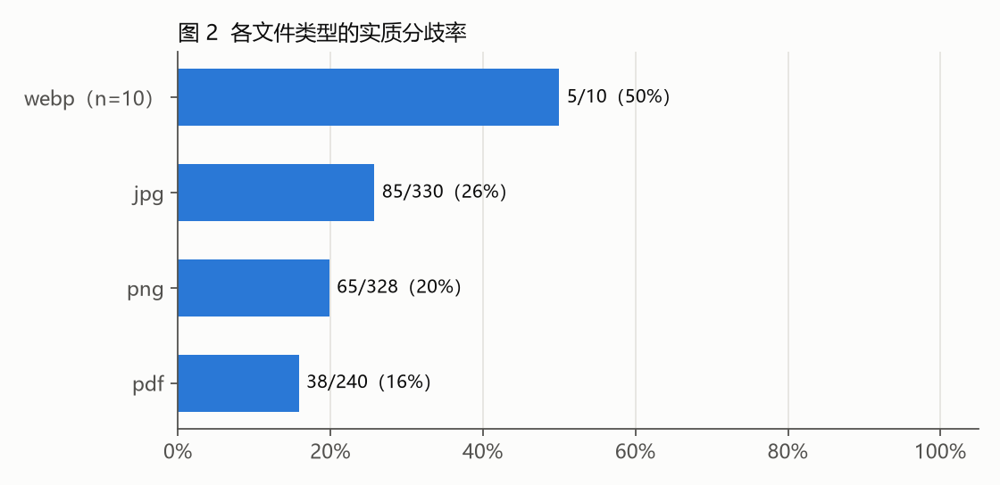
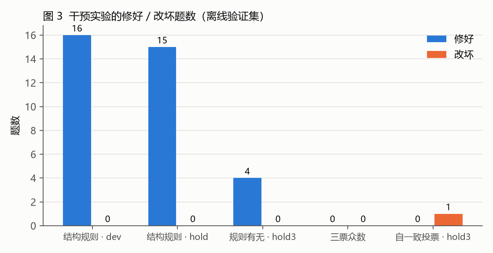

# 多模态表格问答：错误归因与干预实验报告（初稿）

> 版本：v0.2（2026-10-29，已按背靠背外审意见修改）｜作者：Honerable｜数据来源：天池「知乎表格问答」长期赛 S2 本人实验记录
> 口径声明：本报告只使用一次性全量生成的干净底子（82.4 分版本）与离线实验；按平台分数挑选答案得到的版本（含历史最高 84.8）不纳入结论。

## 1. 摘要

- 任务：给定扫描件 / 截图 / PDF 中的表格，回答 908 道问题（提取、推理、结构三类），只能使用阿里云千问系列模型。
- 底子：qwen max 一次全量生成，平台得分 82.4（约答对 748 / 908）。
- 主要发现：
  1. 错误不集中：90 份文档中 79 份有分歧题，最大一份只占 9 题，前 13 份合计 73 / 193，不存在「修一类模板就能大涨」的突破口。
  2. 最大错误块是「提取 + 文字答案」（97 / 359 题有实质分歧）；结构题错误率最高（39 题中 31 题有分歧）。
  3. 可归因的错误机制有 5 类，其中「退化图数字误读」「密排 / 旋转表定位偏行」在放大、分块、方向校正后仍未解决；推测前者可能接近源图质量上限，但尚未用超分辨率等其他手段排除。
  4. 结构题专项规则在合成验证集上有效（dev 8 → 24 / 25，修好 16、改坏 0），但规则看过留出集后再调会过拟合，必须用新布局反例回归。
  5. 同配置自一致投票（三遍取众数）在结构 + 数值题上无可见收益：单遍 46 / 46 / 47，众数 45，净 −1，实花 4.68 元；该验证集不含文字题和数组题，结论不外推到最大分歧块。

## 2. 任务与数据

- 题量：908 题，来自 90 份文档；文件类型 jpg 330、png 328、pdf 240、webp 10。
- 题型 × 答案格式：提取 / 文字 359、提取 / 数值 247、推理 / 数值 118、推理 / 数组 60、结构 / JSON 39 等。
- 评测：平台只返回总分，不返回逐题对错。因此逐题分析依赖两类离线证据：
  - **版本间分歧**：底子与另外 3 个独立运行版本（v1_plus、tiles_plus、max38 混合版）逐题比较；
  - **自建验证集**：按官方版式合成的带金标数据（val_dev / val_hold / val_hold2 / val_hold3），用作「本地合成金标代理」，不等于正式成绩。

## 3. 评测口径

### 3.1 分歧比较的三级口径

早期用全局归一化（NFKC、去空白、小写、yes→是）比较，得到 182 道分歧题；复核发现过度归一化会掩盖差异，改为分类比较：

- **表示差异**（repr）：外侧空白、数值等价、结构题按坐标比较单元格、数组逐位数值等价；
- **软差异**（soft）：大小写、全半角、Yes / No 中英互译（不算无损）；
- **实质差异**（sub）：其余。

改口径后，三个版本与底子的原始字符串不同数分别为 170 / 145 / 122（旧口径 150 / 128 / 106 作废）；取最重差异，实质分歧 193 题，纯表示差异 3 题、软差异 4 题。

### 3.2 留出集污染规则

- 验证集一旦看过结果并据此调规则，就转为开发集，不再称留出集。本项目 val_hold、val_hold2 都因此降级，最终只有 val_hold3 作为干净对照。
- 「分歧」不等于「错误」：分歧题中底子约一半已答对（推测），可修目标约 80～100 题。

## 4. 错误分布

| 维度 | 实质分歧题数 | 说明 |
|---|---|---|
| 提取 | 128 | 其中「提取 / 文字」97 / 359 为最大块，「提取 / 数值」仅 23 / 247 |
| 推理 | 34 | 「推理 / 数组」22 / 60 偏高，「推理 / 数值」仅 4 / 118 |
| 结构 | 31 | 39 题中 31 题有分歧，错误率最高 |
| 合计 | 193 | 79 / 90 份文档出现分歧 |

文件类型分歧率：jpg 26%（85 / 330）> png 20%（65 / 328）> pdf 16%（38 / 240）。是否与扫描质量相关未做分级验证，仅作为后续可检验的假设。

## 5. 错误机制归因

1. **退化图数字误读**：源图像素丢失，人工查看也难以辨认（如合成集 C103d、C202d、C204d、C300d）。已试放大、分块、max 模型，未解决；超分辨率、OCR 交叉核对等手段未试。
2. **密排 / 旋转表定位偏行**：读到相邻行的数（Ed305d、Ed308d、C600d～C604d）。已试方向校正、裁剪、分块、max，未解决。
3. **跨页求和读数错**：C303d 定位到 3 行读数错，计算本身正确，错在取数。
4. **结构题合并格 / 空角格 / 对齐方式**：行列数与单元格坐标错。专项规则有效（见 6.1）。
5. **同配置采样波动**：同模型、同提示词、T=0 重答也会翻转。两张最难图的 8 题中 6 题答案变化（修好 1、改坏 1，净 0）；practice2_dev 60 题翻转 5 题（修好 3、改坏 2）；realdev 26 题翻转 0。

## 6. 干预实验

所有实验遵循「单变量对照 + 修好 / 改坏分开计数」，费用来自本地逐请求账本。

| 实验 | 数据 | 结果 | 结论 |
|---|---|---|---|
| 结构题专项规则（qwen plus） | val_dev 25 题 / val_hold 27 题 | dev 8 → 24 / 25（修好 16、改坏 0）；hold 4 → 19 / 27（修好 15、改坏 0） | 有效 |
| 结构题规则 + max | 同上 | dev 25 / 25、hold 27 / 27 | 有效，但 hold 已用于调规则，降为开发集 |
| 规则有无对照 | val_hold3 结构 28 题 | 有规则 20 / 28、无规则实跑 16 / 28，多对 4 题、无退步 | 规则增益在新数据上成立（无规则组为实际运行结果，不是空占位基线） |
| 旧规则新布局回归 | val_hold2 顶端 / 底端对齐 | 旧规则 0 / 2、0 / 2，新规则 2 / 2、2 / 2 | 改规则后必须用没见过的布局回归 |
| 提取题定向重答（高分辨率、先写表 / 行 / 列 / 单位再答） | 83 道分歧提取题，实跑 82 题（1 题因网络断连与预算上限未跑） | 同底子 53、同历史版本 12、全新 17；原会话记实花 7.79 元（日志只能证明 6.95 元） | 正式题无逐题金标，答案变化无法判对错，不作为有效证据；停止 |
| 自一致投票（max，同配置三遍取众数） | val_hold3 64 题（结构 28 + 数值 36，无文字 / 数组题） | 单遍 46 / 46 / 47，众数 45；修好 0、改坏 1；实花 4.68 元 | 在覆盖题型上无收益，路线关闭 |
| 三票众数（T=0 一票 + T=0.7 两票） | 难图子集 | 修好 0、改坏 0；1.54 元 | 无效 |

## 7. 方法论经验

1. **检查器本身会出假阳性**：校验要区分「JSON 可解析 / 符合业务 schema / 答案语义正确 / 平台接受」四层，按题型和答案格式分别选择校验规则。
2. **归一化过度会掩盖差异**：比较口径应分级，而不是一个全局归一化函数。
3. **看过就不再是留出集**：调规则只能用开发集；每次改规则后补一组新布局反例回归。
4. **只认离线验证，不按提交分挑答案**：按平台分数在候选间挑选属于违规做法（官方工单确认），且会把噪声当信号。
5. **付费实验先定人民币上界**：思考模型必须设 `max_completion_tokens`（思考 + 答案一起限）并逐请求预留；超时 / 5xx / 拿不到用量即停。
6. **分歧分散时先算继续线**：本项目设定「一种此前未解决、能在独立数据复现的机制，且 ≥ 12 道例题、≥ 3 份文档」才继续投入，避免在噪声上烧钱。

## 8. 局限

- 平台不返回逐题对错，正式题上的错误归因依赖版本分歧，不是真实金标。
- 合成验证集按官方版式生成，与真实扫描件的退化分布存在差距。
- 部分样本量很小（如自一致投票 64 题、新布局反例各 2 题），结论只说明「没有可见信号」，不证明方法在任何数据上都无效。

## 9. 后续建议

1. **先补金标再攻最大块**：「提取 / 文字」是最大分歧块，但现有验证集没覆盖。下一步应按官方版式补一组含文字题、数组题的合成留出集，再评估任何干预。
2. **退化图换手段验证上限**：用超分辨率或独立 OCR 交叉核对，区分「模型读错」与「源图不可读」。
3. **结构题规则转成可复用检查项**：合并格、空角格、对齐方式三类做成回归用例，每次改提示词都跑一遍。
4. **评测流程模板化**：冻结计划 → 预算闸 → 冻结结果后才读金标 → 修好 / 改坏分开计数，这套流程可直接迁移到其他多模态问答评测。

## 附录：证据位置

> 以下路径指本机比赛工作目录；比赛数据与答案不随仓库公开，仓库只含脚本与配图。

- 错题地图：`direction_20261027/error_map.md`、`disagree_ids.json`
- 分类比较与聚类：`direction_20261027/diag.py`、`cluster.py`、`diag_report.md`（仓库 `scripts/` 内为去掉本机路径的副本）
- 自一致投票：`direction_20261027/sc/score.log`
- 结构专项：`struct_pilot.py`、`val_hold2/`、`val_hold3/`
- 提取题定向重答：`locate_20261019/run_locate.py`、`compare.json`
